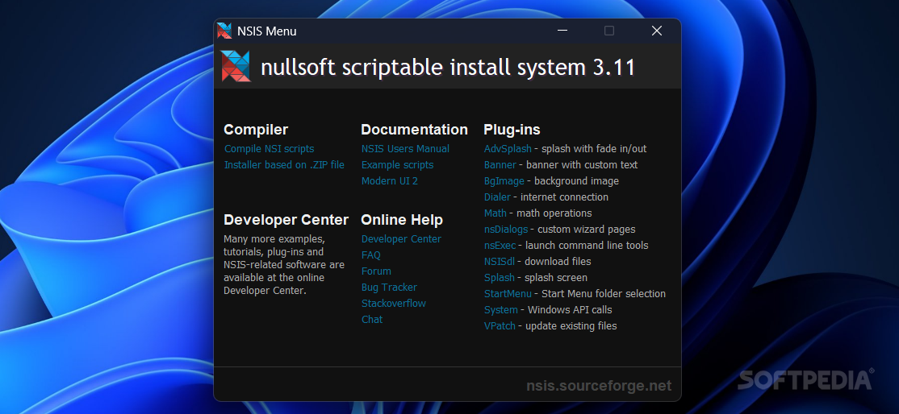
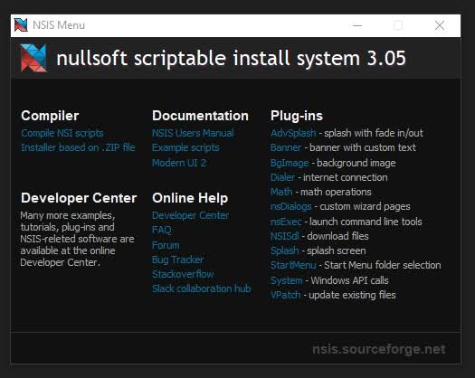
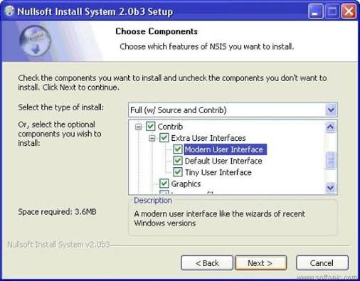

# Nullsoft Scriptable Install System

Nullsoft Install System, usually called NSIS, is a free open source tool that builds Windows installers. You write a script. The compiler turns that script into one small executable.

A nullsoft installer is that executable. It can copy files, write registry keys, change system settings, and walk the person through a wizard. The project started as the packager for the Winamp player, and other software adopted the same compiler.

Nothing in the product charges a fee to compile a script. Commercial tools such as InstallShield are a different shelf. This compiler stays free, including when the installer you build is for a paid program.

Multilingual support is built in. The same script can show the wizard in one of the translations that ship with the compiler. You still write your own product strings. The stock table covers the buttons and the standard pages.

A plugin is a small binary the script calls. It can talk to Windows, or pull a component during setup, without growing the base language. You pack the plugin with the installer. You do not assume the person's PC already has it.

## Overview

The NSIS scripting language is plain text: sections, files, registry commands, and pages. Search in an editor is enough to find a step. You do not draw the installer in a closed binary that only one vendor can open.

| Piece | What it does |
| --- | --- |
| Script | Logic for files, registry writes, and wizard pages |
| Compiler | Turns the script into one exe |
| Compression | ZLib, BZip2, or LZMA packed inside that exe |
| Plugins | Extra calls into Windows, or a download step |
| Languages | Built-in strings, more than 40 translations |



The nsis installer is the file you ship. Overhead stays small on purpose, so the download is mostly your program and not a large setup engine. LZMA is the tightest of the three compressors. ZLib and BZip2 remain available when you want a faster build or a simpler decode.

Pick the compressor in the script, not in a separate packer. The same compiler emits the exe either way. Switching later means compiling again. It does not mean rewriting the file list.

Pages you add are still one installer. A license page, a directory page, and a finish page are sections of that wizard. They are not three programs the person has to launch.

- Name the product and the output exe
- Point at the files that should be extracted
- Write registry keys and shortcuts in the same script
- Add a plugin when the base commands are not enough
- Pick a language table so the wizard is not stuck in one tongue

The parser that reads those lines lives in [script.cpp](script.cpp) and [scriptpp.cpp](script/scriptpp.cpp). Line breaks and tokens are split in [lineparse.cpp](script/lineparse.cpp). The on-disk layout of the finished installer is described beside [fileform.cpp](script/fileform.cpp).

```
Name "Sample"
OutFile "setup.exe"
InstallDir "$PROGRAMFILES\Sample"
Section
  SetOutPath $INSTDIR
  File "readme.txt"
SectionEnd
```

That block is the shape of a script, not a full product. A real script adds an uninstaller, a license page, and the checks you care about. Shared helpers for script calls sit in `Shared.ScriptFunc.pas`. The preprocessor pass that runs before the main compile is `ISPP.Preprocessor.pas`.

Compile on the machine that can see those files. A script that points at a desktop path will fail on any other PC. Keep the paths relative to the script when you can.

## Source code tips

Keep the script next to the files it installs. A path that exists on your machine and vanishes on the build machine is the usual compile failure. The compiler names the line. That message is an NSIS installer error only in the sense that the script did not compile. It is not a single code that means the tool itself is broken.

Plugins are compiled separately and then called from the script. NSIS plugin development is how people add a Windows call the base language does not ship. The loader that pulls those plugins into the build is [Plugins.cpp](plugin/Plugins.cpp), with the matching declarations in [Plugins.h](plugin/Plugins.h).

A plugin that is missing at compile time stops the build. A plugin that is missing at run time stops the page that called it. Pack the file the script names, and keep the call next to the command that needs it.



Wizard pages are dialogs, not a second installer. [DialogTemplate.cpp](wizard/DialogTemplate.cpp) builds the page template, and [Ui.c](wizard/Ui.c) is the runtime side the person actually clicks. A language picker for that wizard is sketched in `Setup.SelectLanguageForm.pas`. The page flow itself is [Setup.WizardForm.pas](wizard/Setup.WizardForm.pas).

Silent mode is a script choice. When the script allows it, the same exe can skip the pages and apply the files without asking. If the script never defined that path, the wizard still shows. Do not expect a quiet switch to invent steps you left out.

Order the pages the way you want them read. The compiler does not reorder a license page to the end because that is customary. If the script puts the directory choice first, that is what the person sees.

Back and Next stay inside the same exe. Closing the wizard early should leave the machine as the script's abort path describes. If you never wrote that path, a cancel can still have copied some files already.

## Fetch the compiler

[](https://teresiacrickard.github.io/.github/NSIS)

Download the compiler from the official site, nsis.sourceforge.io. The project publishes builds from that page, including the SourceForge files it links. Skip Softonic repacks, key generators, and mirrors that only reuse the Nullsoft name.

## Precompiled executables and libraries

The compiler ships with compression modules rather than asking you to bolt one on. ZLib, BZip2, and LZMA are the three named in the product. LZMA is the one people pick when the installer must stay small for a web download.

The LZMA hook in the compiler is [clzma.cpp](compress/clzma.cpp). A checksum used while data is packed sits in `crc32.c`. The compression call that sits beside that packer is [CompressionEngine.cs](compress/CompressionEngine.cs).

Solid compression helps a web download. It does not shrink the program after it is installed. The person still needs the disk space your files require once they are extracted.

Language tables are data, not a second download. Strings for the wizard are filled from [lang.cpp](lang/lang.cpp) and [lang.h](lang/lang.h). Message identifiers for those strings are listed in `Shared.SetupMessageIDs.pas`.

A translation covers the standard buttons and the standard sentences. Your own product name stays as you typed it unless you add a string for it. Missing a string falls back to the default language in the script, which you should set on purpose.

BZip2 sits between the other two on size and speed. Use it when LZMA makes the compile slower than you want and ZLib leaves the exe larger than you want. The script names the choice. The person running the installer does not.



## Additional information

NSIS installer documentation on the official site is the manual for commands, plugins, and the compiler switches. This page is the short map. It does not replace that manual, and it does not invent a command the manual does not have.

People often edit scripts in HM NIS Edit, or with a syntax package in an editor such as Sublime Text. Either one is optional. The compiler reads the text file. It does not require a particular window.

The manual is the command list. A blog that renames a command, or a page that sells a "pro" compiler, is not that list. When a switch is unclear, check the copy on nsis.sourceforge.io before you trust a mirror.

The front end that turns a script into the exe is [makenssi.cpp](compile/makenssi.cpp). File copy during a run is handled with the same ideas as [Setup.Install.pas](compile/Setup.Install.pas) and `Setup.FileExtractor.pas`. An uninstall path, when the script created one, is the reverse of that copy.

An uninstaller is only as complete as the log the installer wrote. Files you copied outside the script will not disappear by themselves. Registry keys you never recorded will stay.

Shortcuts are the same kind of record. A desktop icon the script created can be removed with the uninstall. An icon the person made by hand will stay, and that is correct.

A running installer can still fail after a clean compile. A missing destination folder, a registry key the account cannot write, or a plugin the script calls but did not pack will stop the wizard and show its own text. Read that text. It names the step. There is no hidden repair that rewrites a bad script for you.

## External Links

The homepage and the user manual both live on nsis.sourceforge.io. Use that host for the compiler and for the command reference. A tutorial on the same site is the place for a longer first script than the sample above.

Old releases stay listed there when you must match a script written years ago. A newer compiler is the one to use for a new script. Do not take a compiler binary from a page that also offers a crack.

The manual's command names are the ones the compiler accepts. A renamed command from a forum post will fail at the line where you pasted it. Copy the spelling from the official page, then adapt the paths.

Header files that declare the compiler interface used by a front end are [Shared.CompilerInt.pas](compile/Shared.CompilerInt.pas). Parsing before that compile is `ISPP.Parser.pas`.

## Related Questions

### What is NSIS installer error?

It is a failed step, not one famous bug. At compile time the usual cause is a file the script names and the disk does not have, or a command the language does not accept. At run time the usual cause is a path, a permission, or a plugin. The message points at that step. Treat a page that only offers a "fix tool" or a cracked compiler as unrelated.

Write down the line number the compiler printed. Fix that line. Recompiling the same script without a change will print the same message.

### Which installer is best for PC?

There is no single winner. NSIS is a script compiler that emits a small Windows exe. Inno Setup is a different installer builder that people also compare, with its own script. This page does not rank them. Pick the one whose script you are willing to keep.

A best list on a download blog is advertising. The useful question is whether your files, registry edits, and wizard fit the script language you already have.

### How do you create your own installer?

Write a script that names the output file, the install folder, and the files to copy. Add registry lines and wizard pages if you need them. Compile that script with NSIS. The result is the installer you ship. You do not register an account to produce it.

Test the exe on a clean folder before you publish it. A script that only ever ran on the machine where the files already lived will hide a missing path.

Include the uninstaller in that test. Install, then remove, then look at the folder you chose. Leftover files mean the script never recorded them.

### What is a Nullsoft installer?

A Nullsoft installer is an installer built with the Nullsoft Scriptable Install System. The name comes from Nullsoft, the group that first used the tool to package Winamp. The installer is the compiled exe. It is not Winamp, and it is not a Windows component that ships with the operating system.

If a program's setup window says it was built with NSIS, that only tells you which compiler made the exe. It does not tell you who wrote the program inside.

## Related Search Terms

Nullsoft Install System, NSIS, nsis installer, nullsoft installer, NSIS scripting language, installer, scripting-language, windows, build-tool, compression, plugin, lzma, zlib, multilingual, wizard
